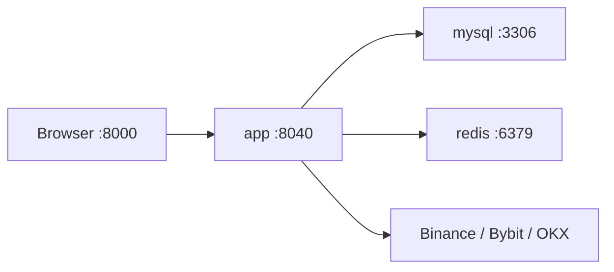

# Docker 一体化测试环境

## 1. 目标

Docker 测试环境用于在本机一次性启动：

- `app`：Go 后端和编译后的 React 前端，容器端口 `8040`。
- `mysql`：MySQL 8.4，保存 gin-admin、Trading、Runtime 和审计数据。
- `redis`：Redis 7.4，保存缓存、验证码、登录令牌和限流数据。

浏览器只访问 `http://localhost:8000`。前端静态文件和 `/api/v1/*` API 使用同一域名，不需要额外 Nginx，也没有跨域问题。



## 2. 文件说明

| 文件 | 作用 |
| --- | --- |
| `Dockerfile` | Node 构建前端、Go 构建后端、Alpine 运行镜像 |
| `compose.yaml` | 编排 app、MySQL、Redis、健康检查和数据卷 |
| `docker/.env.example` | 本地测试环境变量模板 |
| `docker/docker-entrypoint.sh` | 启动时检查环境变量并渲染 TOML |
| `configs/docker/*.template` | Docker 专用 MySQL、Redis、JWT 配置模板 |
| `.dockerignore` | 排除 Git、Node modules、已有构建产物和本地数据 |

镜像和服务版本固定为：

- Go `1.26.5-alpine3.24`
- Node.js `22.23.2-alpine3.24`
- MySQL `8.4.11`
- Redis `7.4.10-alpine`

这些镜像均支持 Apple Silicon `arm64` 和常用的 `amd64`。

## 3. 安装 Docker Desktop

当前机器是 Apple Silicon macOS，但终端尚未安装 `docker` 命令。先安装 Apple Silicon 版 Docker Desktop：

1. 打开 [Docker Desktop for Mac 官方安装说明](https://docs.docker.com/desktop/setup/install/mac-install/)。
2. 下载 Apple silicon 版本，将 Docker 拖入 Applications。
3. 启动 Docker Desktop，等待状态显示 Engine running。
4. 在新终端验证：

```bash
docker version
docker compose version
```

建议 Docker Desktop 至少分配 4 CPU、8 GB 内存和 20 GB 磁盘。第一次构建需要下载 Go、Node、MySQL、Redis 镜像和项目依赖。

## 4. 初始化环境变量

进入项目：

```bash
cd /Users/tomodel/Desktop/work/gowork/src/github.com/nofx-gin-admin
make docker-env
```

该命令只在文件不存在时，把 `docker/.env.example` 复制为 `docker/.env`。`docker/.env` 已加入 `.gitignore`。

首次启动前编辑 `docker/.env`，至少替换：

- `MYSQL_PASSWORD`
- `MYSQL_ROOT_PASSWORD`
- `REDIS_PASSWORD`
- `JWT_SIGNING_KEY`
- `DATA_ENCRYPTION_KEY`

生成安全值：

```bash
openssl rand -hex 24
openssl rand -base64 32
```

`DATA_ENCRYPTION_KEY` 必须使用 `openssl rand -base64 32` 的结果。首次写入交易所或模型凭证后必须保持稳定，随意更换会导致已有密文无法解密。轮换时先把旧值放入 `DATA_ENCRYPTION_KEY_PREVIOUS`。

测试管理员默认值：

```text
账号：admin
密码：abc-123
```

这是当前遗留 MD5 登录协议的测试账号，只允许本机测试使用。容器端口全部绑定到 `127.0.0.1`，不会监听局域网地址。

环境变量值当前应使用字母、数字、下划线或连字符，避免双引号、换行、`@`、`:`、`/` 等会影响 TOML 或 MySQL DSN 的字符。

## 5. 校验并启动

先校验 Compose 展开结果：

```bash
make docker-config
```

注意：展开结果会包含本地测试密码，不要把输出粘贴到公开日志或提交到 Git。

构建并启动：

```bash
make docker-up
```

等三个服务变为 healthy：

```bash
make docker-ps
```

查看启动日志：

```bash
make docker-logs
```

首次构建通常耗时较长。应用会等待 MySQL 和 Redis 健康后再启动，并在测试环境执行 `AutoMigrate` 创建 gin-admin 与 `trading_*` 表。

本机 Compose 默认通过清华 TUNA 镜像下载 Alpine 软件包，并通过 `DOCKER_GOPROXY` 下载 Go 模块；两者都可以在 `docker/.env` 中覆盖。Docker 专用变量不会被宿主机的全局 `GOPROXY` 干扰。直接执行 `docker build` 时仍默认使用官方软件源。

## 6. 访问和验证

健康检查：

```bash
make docker-test
curl -i http://127.0.0.1:8000/health
```

访问地址：

| 功能 | 地址 |
| --- | --- |
| 管理系统 | `http://localhost:8000/` |
| Swagger | `http://localhost:8000/swagger/index.html` |
| OpenAPI JSON | `http://localhost:8000/openapi.json` |
| MySQL 宿主机端口 | `127.0.0.1:3307` |
| Redis 宿主机端口 | `127.0.0.1:6380` |

登录后至少验证：

1. 首页和系统菜单正常加载。
2. `/api/v1/current/user` 返回当前用户。
3. 在“交易配置”中创建、编辑、连接测试和删除交易所、模型与策略。
4. 在“Trader 管理”中创建 Trader，并验证启动预检、停止和立即同步操作。
5. 账户快照、仓位和决策页面返回空分页而不是 404/500。
6. 重启 app 后 MySQL 数据仍存在。

API 验证需要登录令牌，也可以直接在 Swagger 中操作。Trading 前端已包含交易配置、Trader 管理、账户快照、仓位记录和决策记录五类菜单页面；若菜单缺失，应先检查当前角色的菜单和按钮资源授权。

## 7. 常用命令

```bash
# 查看容器
make docker-ps

# 跟踪全部核心日志
make docker-logs

# 停止并删除容器，保留 MySQL/Redis 数据卷
make docker-down

# 重新构建 app
docker compose --env-file docker/.env build --no-cache app
docker compose --env-file docker/.env up -d

# 进入应用容器
docker compose --env-file docker/.env exec app sh

# 连接 MySQL
docker compose --env-file docker/.env exec mysql \
  mysql -u"$MYSQL_USER" -p"$MYSQL_PASSWORD" "$MYSQL_DATABASE"

# 连接 Redis
docker compose --env-file docker/.env exec redis \
  redis-cli -a "$REDIS_PASSWORD"
```

直接在宿主机执行最后两个命令时，Shell 不会自动加载 `docker/.env`。可以先执行 `set -a; . docker/.env; set +a`，或者在容器内手工输入密码。

## 8. 清空测试数据

以下命令会永久删除 Docker 测试环境中的 MySQL、Redis 和应用数据：

```bash
docker compose --env-file docker/.env down -v --remove-orphans
```

只需要重建应用时不要加 `-v`。

## 9. 旧 NOFX 数据导入

如果旧 NOFX 数据库也在宿主机，容器不能用 `127.0.0.1` 访问宿主机，应使用 `host.docker.internal`：

```bash
docker compose --env-file docker/.env exec app xtrading import-nofx \
  --workdir /app/runtime-config \
  --config . \
  --source-type mysql \
  --source-dsn 'legacy:password@tcp(host.docker.internal:3306)/nofx?charset=utf8mb4&parseTime=True&loc=UTC' \
  --default-owner root
```

默认是 dry-run。核对 JSON 报告并备份数据库后，追加 `--apply` 才会正式写入。

## 10. 排障

### `docker: command not found`

Docker Desktop 尚未安装，或安装后终端未重新打开。先启动 Docker Desktop，再执行 `docker version`。

### 端口被占用

修改 `docker/.env`：

```text
APP_PORT=8001
MYSQL_PORT=3308
REDIS_PORT=6381
```

### MySQL 一直 unhealthy

```bash
docker compose --env-file docker/.env logs --tail=200 mysql
```

常见原因是旧数据卷使用了另一组初始化密码。测试数据不需要保留时，执行第 8 节的清空命令后重建。

### app 启动失败

```bash
docker compose --env-file docker/.env logs --tail=300 app
```

重点检查：缺少环境变量、MySQL DSN 特殊字符、`DATA_ENCRYPTION_KEY` 长度、数据库迁移错误。

### Apple Silicon 构建很慢

不要强制指定 `linux/amd64`。当前固定镜像均支持 `arm64`，Docker Desktop 会直接构建本机架构镜像。

## 11. 与生产环境的边界

这套 Compose 仅用于本机集成测试：

- 开启 Debug、Swagger 和 `AutoMigrate`。
- 使用单实例 app、单实例 MySQL、单实例 Redis。
- 没有 TLS、备份、监控、KMS、网络隔离和高可用。
- 测试管理员仍使用遗留 MD5 协议。

生产部署必须关闭 `AutoMigrate` 和 Debug，使用版本化数据库迁移、TLS、KMS/Secret Manager、独立备份、监控告警及更安全的管理员初始化流程。
