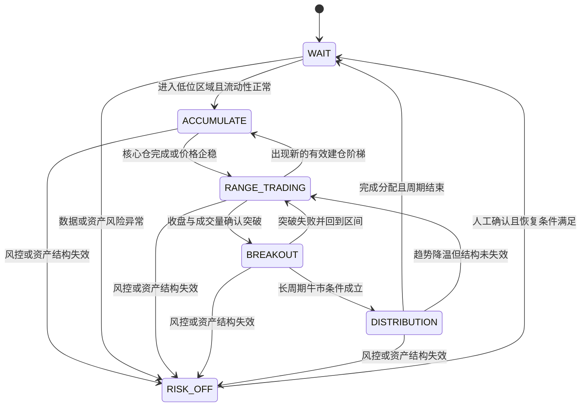

# 现货核心-卫星分层策略规格与实现说明

## 1. 文档状态

- 策略名称：现货核心-卫星分层建仓与波段减仓策略
- 策略编码：`spot_core_satellite`
- 当前阶段：参数、状态机、历史行情回测、模拟 Trader、逐笔 Lot 账本、API 与前端页面已实现
- 实盘边界：服务端强制仅允许模拟 Trader；`allow_live_execution=false`，不会创建真实交易命令
- 适用市场：现货，仅使用自有资金
- 不支持：杠杆、借币、做空、合约、无限补仓
- 主要目标：以低于满仓持有的回撤，获得可重复的震荡收益并保留长期上涨敞口

本文中的默认值仅用于第一轮回测，不代表实盘建议。任何参数进入实盘前，都必须经过样本外、压力和小资金测试。

## 2. 策略定义

该策略由三个资金桶和六个运行状态组成。

### 2.1 资金桶

| 资金桶 | 职责 | 买入来源 | 卖出规则 |
|---|---|---|---|
| 核心仓 `core` | 保留长期现货敞口，形成成本锚点 | 低位区域的有限阶梯建仓 | 仅在分配阶段分批卖出，波段规则不得动用 |
| 波段仓 `satellite` | 在震荡中低买高卖 | 回撤、支撑或波动触发 | 压力位、目标净利润、突破后分批止盈 |
| 现金仓 `reserve` | 支持后续补仓并控制风险 | 初始预算及卖出回款 | 不得低于配置的最低现金比例 |

三个资金桶必须独立核算数量、成本、手续费、已实现盈亏和占用资金。交易所账户中的总余额不能代替策略内部账本。

### 2.2 收益来源

1. 核心仓随长期价格上涨产生的资产升值。
2. 波段仓在震荡区间内产生的已实现价差。
3. 分批建仓降低单次择时错误对总体成本的影响。
4. 现金储备降低深度下跌时被迫停止执行的概率。

策略不应把“降低平均成本”表述为已经产生收益；只有卖出并扣除费用后才形成已实现收益。

## 3. 参数表

本节只列当前回测引擎实际读取的参数。界面未开放编辑的分层数组仍使用后端默认值，不属于隐式自由参数。

### 3.1 市场与周期参数

| 参数 | 类型 | 当前默认值 | 约束 | 说明 |
|---|---:|---:|---|---|
| `exchange` | enum | `binance` | `binance/okx` | 读取现货历史 K 线，不使用账户凭证 |
| `symbol` | string | `BTCUSDT` | USDT 现货交易对 | OKX 请求时规范化为 `BTC-USDT` |
| `market` | enum | `spot` | 当前固定 | 禁止把合约仓位混入现货 Lot 账本 |
| `quote_asset` | string | `USDT` | 当前固定 | 统一资金、成本和收益基准 |
| `execution_timeframe` | enum | `1d` | `4h/1d` | 收盘产生信号，下一根 K 线开盘执行，防止未来函数 |

### 3.2 资金与仓位参数

| 参数 | 类型 | 当前默认值 | 约束 | 说明 |
|---|---:|---:|---|---|
| `strategy_budget_usdt` | decimal | `10000` | `> 0` | 策略独立预算，不等于账户全部资产 |
| `core_budget_ratio` | percent | `35%` | `> 0` | 底仓最大预算 |
| `satellite_budget_ratio` | percent | `25%` | `> 0` | 波段仓最大预算 |
| `minimum_cash_ratio` | percent | `40%` | `>=20%` | 任何买入后均不得低于该初始资金比例 |
| `max_symbol_exposure_ratio` | percent | `60%` | `<= 100% - minimum_cash_ratio` | 未核销 Lot 含费成本占初始资金的上限，不是币价上涨后的市值占比 |
| `core_minimum_retention_ratio` | percent | `10%` | `0%..100%` | 分配后仍需保留的原始核心仓数量比例 |

`core_budget_ratio + satellite_budget_ratio + minimum_cash_ratio` 必须严格等于 `100%`。

### 3.3 低位区域与底仓建仓参数

| 参数 | 类型 | 当前默认值 | 约束 | 说明 |
|---|---:|---:|---|---|
| `low_area_lookback_bars` | int | `365` | `>=20` | 计算滚动高点；单位为当前周期的 K 线根数 |
| `low_area_drawdown_pct` | percent | `35%` | `0%..100%` | 相对滚动高点达到该回撤并企稳后，才允许进入建仓状态 |
| `trend_filter_period` | int | `200` | `>=20` | 长期均线周期，用于核心仓分配阶段确认 |
| `stabilization_bars` | int | `5` | `>=1` | 最近若干根 K 线不再持续创新低后，才允许建仓 |
| `accumulation_drawdowns` | list | `0,5,10,16,24,34%` | 严格递增，最多 8 层 | 相对首次建仓锚点的回撤阶梯 |
| `accumulation_weights` | list | `1,1,1.2,1.4,1.6,1.8` | 与阶梯数量一致 | 归一化后分配 35% 底仓预算 |
| `accumulation_cooldown_bars` | int | `2` | `>=1` | 两次买入至少间隔的 K 线数量 |

权重禁止采用 `1,2,4,8...` 等翻倍结构，避免策略退化为马丁格尔。

### 3.4 波段仓参数

| 参数 | 类型 | 当前默认值 | 约束 | 说明 |
|---|---:|---:|---|---|
| `satellite_entry_drawdowns` | list | `3,5,8,12%` | 严格递增 | 相对近期压力位的回撤分层，每层默认等额使用波段预算 |
| `satellite_take_profit_ratio` | percent | `3%` | `0%..100%` | 单个 Lot 的最低净收益门槛；达到后只成为可卖候选，不会立即卖出 |
| `satellite_sell_ratio` | percent | `100%` | `0%..100%` | 突破确认后，每个达标 Lot 卖出自身剩余数量的比例 |
| `resistance_lookback_bars` | int | `30` | `>=5` | 计算近期压力位 |
| `breakout_confirm_bars` | int | `2` | `>=1` | 连续收盘突破压力位的确认数量 |
| `breakout_volume_multiplier` | decimal | `1.2` | `>=1.0` | 最新成交量相对回看期均量的最低倍数 |

波段卖出必须同时满足：Lot 已达到含双边费用的目标价、价格突破确认、成交量确认。只达到 `3%` 不会单独触发卖出。

### 3.5 核心仓分配参数

| 参数 | 类型 | 当前默认值 | 约束 | 说明 |
|---|---:|---:|---|---|
| `distribution_lookback_bars` | int | `365` | `>=20` | 长周期突破窗口，单位为 K 线根数 |
| `distribution_step_gain_pct` | percent | `15%` | `0%..100%` | 进入分配状态后，每继续上涨一个档位触发一次减仓 |
| `distribution_step_sell_ratio` | percent | `10%` | `0%..100%` | 每档卖出当前核心仓剩余数量的比例 |
| `max_core_distribution_ratio` | percent | `70%` | `0%..100%` | 一个周期最多卖出的原始核心仓比例 |
| `core_minimum_retention_ratio` | percent | `10%` | `0%..100%` | 分配后至少保留的原始核心仓比例 |

### 3.6 风控与成本参数

| 参数 | 类型 | 当前默认值 | 约束 | 说明 |
|---|---:|---:|---|---|
| `enable_drawdown_risk_control` | bool | `true` | 可关闭 | 是否在策略权益达到最大回撤线时进入 `RISK_OFF`；不影响低位和分层买入使用的价格回撤 |
| `max_strategy_drawdown_pct` | percent | `25%` | `0%..100%` | 权益从峰值回撤达到后进入 `RISK_OFF`，停止新买入，不强制卖出 |
| `max_daily_buy_ratio` | percent | `10%` | `0%..100%` | 按 UTC 自然日累计的买入资金上限 |
| `fee_rate_bps` | decimal | `10` | `>=0` | 单边手续费；10 BPS 等于 0.10% |
| `slippage_bps` | decimal | `5` | `>=0` | 买入价向上、卖出价向下调整的基础滑点 |
| `stress_slippage_bps` | decimal | `20` | `>= slippage_bps` | 压力场景滑点；当前单次基础回测仍使用基础滑点 |
| `allow_live_execution` | bool | `false` | 当前强制关闭 | 当前版本只产生回测成交，不提交真实订单 |

关闭 `enable_drawdown_risk_control` 后，系统仍计算并展示最大回撤，也仍执行低位区域、底仓阶梯和波段阶梯的价格回撤逻辑；唯一变化是权益回撤达到 `max_strategy_drawdown_pct` 时不再自动进入 `RISK_OFF`。该开关默认开启。

ATR 自适应阶梯、压力位容差、触压减仓、移动止盈、订单 TTL、月换手上限、最低成交额、最大价差和手动恢复仍是后续增强项。当前引擎不会读取这些参数，未实现前不得用于回测调优。

## 4. 状态转换



### 4.1 状态转换表

| 当前状态 | 目标状态 | 必要条件 | 系统动作 | 禁止动作 |
|---|---|---|---|---|
| `WAIT` | `ACCUMULATE` | 白名单、回撤达到低位门槛、数据完整、流动性合格 | 创建建仓锚点，计算有限阶梯 | 一次性买满核心仓 |
| `ACCUMULATE` | `ACCUMULATE` | 触发下一阶梯、冷却结束、现金和敞口充足 | 买入对应核心仓层级 | 超层数、超预算或翻倍补仓 |
| `ACCUMULATE` | `RANGE_TRADING` | 核心仓达到目标，或企稳条件满足 | 固定核心仓账本，初始化波段锚点 | 把核心仓转为可随意卖出的库存 |
| `RANGE_TRADING` | `ACCUMULATE` | 出现更深有效阶梯且核心预算未用完 | 只使用剩余核心预算 | 使用波段预算冒充核心预算 |
| `RANGE_TRADING` | `BREAKOUT` | 连续收盘突破压力位且成交量达标 | 卖出配置比例的波段仓，剩余仓启用移动止盈 | 突破瞬间清空全部底仓 |
| `BREAKOUT` | `RANGE_TRADING` | 收盘重新跌回突破位且未触发长期风险 | 关闭移动止盈，重建波段区间 | 追高接回刚卖出的仓位 |
| `BREAKOUT` | `DISTRIBUTION` | 长期均线向上且突破长周期高点 | 建立核心仓分配阶梯 | 大规模新增核心仓 |
| `DISTRIBUTION` | `DISTRIBUTION` | 达到下一上涨档位和冷却要求 | 按档位卖出核心仓 | 卖出超过最大分配比例 |
| 任意状态 | `RISK_OFF` | 超最大回撤、数据异常、下架风险、价差或流动性异常 | 撤销未成交买单，停止新增风险，写入审计 | 自动恢复、继续补仓 |
| `RISK_OFF` | `WAIT` | 数据与市场恢复，并经人工确认 | 清除暂停状态，重新评估周期 | 直接恢复到原建仓档位并补单 |

## 5. 订单与账本规则

1. 每个订单意图必须包含 `strategy_id`、`cycle_id`、`bucket`、`layer` 和幂等键。
2. `bucket=core` 的卖出只能由 `DISTRIBUTION` 产生；波段止盈只能卖出 `satellite` 库存。
3. 买入前校验可用 USDT、最低现金、总敞口、单币敞口、最小名义价值和价格精度。
4. 卖出数量不得超过对应资金桶的已成交可用数量。
5. 部分成交按实际成交数量和费用更新资金桶，不按委托数量记账。
6. 限价单过期后先撤单，再根据新状态重新计算；禁止简单改成市价追单。
7. 所有收益均使用净值：卖出收入减去对应成本、双边手续费和滑点。
8. 状态转换、参数版本、订单意图、成交、撤单和人工恢复均写入不可变事件。
9. AI 可以输出市场状态建议，但不得直接修改预算、突破条件或绕过应用层风控。

### 5.1 买入批次与卖出核销

同一币种的多次买入必须建立独立逻辑批次 `lot`。交易所账户中的现货数量可以混合，但策略账本不得使用账户平均成本替代批次成本。

每个买入批次至少记录：

- `strategy_id`：所属策略实例。
- `cycle_id`：所属策略周期。
- `bucket`：`core` 或 `satellite`。
- `layer_no`：建仓或波段层级。
- `source_buy_fill_id`：产生该批次的真实买入成交。
- `acquired_qty`、`remaining_qty`、`reserved_qty`：原始、剩余和已被卖单预占的数量。
- `unit_cost`：分摊买入手续费后的单位成本。
- `target_net_profit_rate`、`target_price`：批次自己的净利润门槛和目标价格。

卖出时必须显式指定一个或多个 `source_lot_id`，并按实际卖出成交建立 `sell_allocation` 核销记录。买入批次和成交记录保持不可变，只减少 `remaining_qty`，禁止删除或覆盖原始成本。

例如价格分别为 `78000`、`65000`、`58000` 的三次买入形成三个批次。当 `58000` 批次达到自己的净利润目标时，只允许卖出该批次的可用数量或配置比例；另外两个批次不因账户中币种相同而自动被核销。

第一阶段采用以下确定性规则：

1. 策略生成卖出意图时必须明确批次，不使用隐式 FIFO 或账户平均成本。
2. 同一信号有多个批次满足条件时，按 `target_price` 从低到高、`opened_at` 从新到旧排序。
3. 核心仓与波段仓禁止交叉核销。
4. 部分成交按实际成交数量逐批核销，未成交部分继续处于 `reserved` 状态或在撤单后释放。
5. 一笔卖出成交可以核销多个批次，但每个分配项的数量、成本、双边费用和已实现盈亏必须独立保存。
6. 所有分配数量之和必须等于卖出成交数量；无法完成分配时整笔账务事务回滚并进入人工核对。

### 5.2 批次净利润

单个批次的已实现净利润按实际核销数量计算：

```text
allocated_cost = unit_cost * allocated_qty
net_proceeds = sell_price * allocated_qty - allocated_sell_fee
realized_pnl = net_proceeds - allocated_cost
realized_pnl_rate = realized_pnl / allocated_cost
```

其中 `unit_cost` 已包含分摊后的买入手续费。若手续费以 BNB 或其他币种支付，必须使用成交时的 USDT 公允价值换算后再计入批次成本。

## 6. 回测规范

### 6.1 数据要求

- 至少使用 `1h/4h/1d` 现货 OHLCV，按交易所和交易对独立回测。
- 使用当时真实存在的交易对、价格精度、数量精度和最小名义价值，避免幸存者偏差。
- 数据区间应覆盖完整牛市、熊市、震荡和快速崩跌，建议不少于 5 年；上市不足 5 年的币种使用全部可用历史。
- 信号只能读取当前 K 线之前已经收盘的数据，订单最早从下一根 K 线开始成交。
- 缺失 K 线、异常价格和停牌区间必须显式记录，不允许前向填充后继续交易。
- 手续费、滑点、限价单未成交、部分成交和最小订单限制必须进入成交模型。

### 6.2 成交模型

| 场景 | 保守回测规则 |
|---|---|
| 限价买单 | 后续 K 线最低价穿过限价后，按限价加买入滑点成交 |
| 限价卖单 | 后续 K 线最高价穿过限价后，按限价减卖出滑点成交 |
| 同一 K 线同时触发止盈和止损 | 使用对策略更不利的成交顺序 |
| 跳空越过价格 | 按开盘价或更不利价格成交，不使用无法获得的目标价 |
| 成交量不足 | 按 K 线成交量参与率限制部分成交 |
| 订单过期 | 撤单，不假设必然成交 |

### 6.3 对照组

所有对照组使用相同初始资金、相同交易所数据和相同费用模型：

1. 全额现货买入并持有。
2. 固定周期、固定金额 DCA。
3. 当前固定区间现货网格。
4. 仅核心仓、不做波段。
5. 核心-卫星策略本身。

### 6.4 关键指标

| 指标组 | 指标 |
|---|---|
| 收益 | 总收益率、年化收益、已实现收益、未实现收益、波段净收益 |
| 风险 | 最大回撤、回撤持续时间、下行波动率、最差日/周/月收益 |
| 风险调整 | Calmar、Sortino、Sharpe |
| 交易质量 | Profit Factor、胜率、平均盈亏比、平均持仓时间、交易次数 |
| 成本 | 手续费、滑点、费用占毛利润比例、月换手率 |
| 资金效率 | 平均现金比例、最大资金占用、平均敞口、未使用资金时间 |
| 策略行为 | 各状态持续时间、各层触发次数、核心仓误卖次数、风控暂停次数 |

## 7. 回测验收标准

### 7.1 安全性硬门槛

以下任一失败即判定策略不可进入下一阶段：

- 不产生杠杆、借币、做空或合约订单。
- 任意时点总敞口、单币敞口和最低现金约束均未被突破。
- 不发生波段逻辑卖出核心仓、卖出数量超过库存或余额为负。
- 每笔卖出成交都能完整核销到确定的买入批次，且分配数量总和与成交数量一致。
- 买入批次关闭后 `remaining_qty` 必须为零；未关闭批次不得出现负数或重复核销。
- 同一幂等键不产生重复订单或重复成交记账。
- 不使用未来 K 线、未来成交量或尚未收盘的数据。
- 费用、滑点和未成交订单均进入结果，不允许使用“触价必成交”的乐观模型。
- `RISK_OFF` 后不自动恢复，不继续创建新的买单。

### 7.2 第一轮量化门槛

以下是建议的初始产品门槛，应在获得第一轮结果后评审，而不是反向调参保证通过：

| 指标 | 建议门槛 |
|---|---|
| 最大回撤 | 不高于 `30%`，且至少比同期全额买入持有降低 `20%` |
| 完整周期净收益 | 扣除费用和滑点后为正，且不低于固定周期 DCA |
| 牛市收益保留率 | 不低于同期买入持有收益的 `70%` |
| Calmar | 不低于买入持有和固定 DCA 两个对照组 |
| 波段 Profit Factor | 基础成本场景下 `>= 1.20` |
| 费用占毛利润 | `<= 25%` |
| 单次交易利润贡献 | 最大单笔贡献不超过总利润的 `30%` |
| 参数稳定性 | 关键参数上下浮动 `20%` 后，净收益或 Calmar 不得恶化超过 `30%` |
| 样本外衰减 | 样本外 Calmar 相比样本内下降不超过 `40%` |

### 7.3 压力验收

- 手续费按基础值的 2 倍运行。
- 滑点使用基础、压力两档，并测试流动性下降情形。
- 测试单日快速下跌、连续多日下跌、V 型反转、长期横盘和单边上涨。
- 随机延迟订单一个执行周期，确认收益不依赖精确到单根 K 线的成交。
- 对历史起始日期进行滚动，确认结果不依赖单一入场日期。
- 使用 walk-forward：训练参数和样本外验证区间严格分离。

只有安全性硬门槛全部通过，并且基础、样本外和压力场景均无结构性失效，才能进入交易所测试网或纯模拟实时运行。

`Profit Factor` 只基于已经发生卖出核销的 Lot 计算。如果回测期间只有买入和未实现浮盈、没有任何卖出分配，则该指标标记为 `N/A`，不能显示为 `0`，也不能据此判定策略盈利质量失败。此时应先检查波段 Lot 是否达到净收益目标，以及是否同时出现收盘突破和成交量确认。

## 8. 第一轮回测矩阵

| 维度 | 组合 |
|---|---|
| 交易对 | BTCUSDT、ETHUSDT 分开及组合 |
| 执行周期 | `4h`、`1d` |
| 核心/波段/现金 | `35/25/40`、`30/20/50`、`40/20/40` |
| 低位回撤门槛 | `30%`、`35%`、`40%` |
| 波段最低净利润 | `2%`、`3%`、`5%` |
| 阶梯模式 | 固定百分比、ATR 自适应 |
| 成本场景 | 基础费率、双倍费率、压力滑点 |

矩阵用于观察稳定区间，不应从全部组合中只选择历史收益最高的一组。

## 9. 已确认产品决策

1. 采用独立买入批次账本，不使用账户平均成本决定卖出。
2. 卖出必须显式关联并核销对应买入批次。
3. 核心仓和波段仓独立核算，禁止交叉卖出。
4. 原始买入、订单和成交记录不可删除，部分卖出只更新批次剩余数量并新增核销记录。

## 10. 当前版本产品决策

1. 第一阶段允许 Binance/OKX 的 USDT 现货交易对，不在代码中只限制 BTC 和 ETH；实际启用范围由用户策略和交易所可用市场决定。
2. 突破采用“连续收盘突破近期压力位，并满足成交量倍数”的确认方式；信号在当前 K 线收盘后产生，最早在下一根 K 线开盘成交。
3. 核心仓按 `core_minimum_retention_ratio` 保留最低数量，按 `max_core_distribution_ratio` 限制一个周期内的最大分配量。
4. 低位区域使用滚动高点回撤，并叠加最近 K 线企稳条件；长期均线用于突破后进入分配状态。
5. 核心仓使用有限层级和缓慢递增权重，禁止翻倍马丁格尔；波段仓默认等额分层。
6. `RISK_OFF` 只撤销待执行买入并停止新增风险，不强制卖出核心仓，也不自动恢复。
7. 生产账本通过 `strategy_id + cycle_id + bucket + lot_id` 隔离库存；卖出必须显式引用本策略 Lot，不允许共享账户余额替代策略库存。
8. 回测验收以安全硬门槛、最大回撤和 Calmar 为优先指标，收益率作为随后比较项。

## 11. 实现映射（2026-08-21）

| 能力 | 实现位置 | 状态 |
|---|---|---|
| 参数归一化与安全校验 | `internal/mods/trading/schema/spot_strategy.go` | 已完成 |
| 六状态确定性回测 | `internal/mods/trading/runtime/spot_core_satellite.go` | 已完成 |
| 最低现金、最大成本敞口、自然日买入上限 | 回测引擎与验收结果 | 已完成 |
| Binance/OKX 历史 K 线分页 | `internal/mods/trading/provider/market.go` | 已完成 |
| 异步任务、取消、恢复与结果持久化 | `internal/mods/trading/biz/spot_strategy.biz.go` | 已完成 |
| 买入成交创建 Lot、卖出显式核销与幂等 | `internal/mods/trading/dal/spot_strategy.dal.go` | 已完成 |
| 模拟 Trader 周期重放与决策快照 | `internal/mods/trading/runtime/spot_strategy_cycle.go` | 已完成 |
| 策略工作室参数与独立回测/Lot 页面 | `web/src/pages/trading/Strategies`、`web/src/pages/trading/SpotStrategy` | 已完成 |
| 真实资金自动下单 | 服务端启动门禁 | 默认禁止，需后续单独审计与授权 |

当前实现先完成可验证的回测、模拟运行和账本基础，不把历史重放结果伪装成真实成交。只有交易所返回的实际买入成交才能成为生产 Lot 的事实来源；真实下单开放仍需测试网、小资金和人工风险确认。

回测结果会独立输出 `minimum_cash_ratio`、`maximum_exposure_ratio` 和 `maximum_daily_buy_ratio`。其中最大敞口按尚未核销 Lot 的含费成本占初始策略预算计算，避免把行情自然上涨误判为新增资金越界；4 小时周期的买入额度按 UTC 自然日累计，不会在每根 K 线重置。
