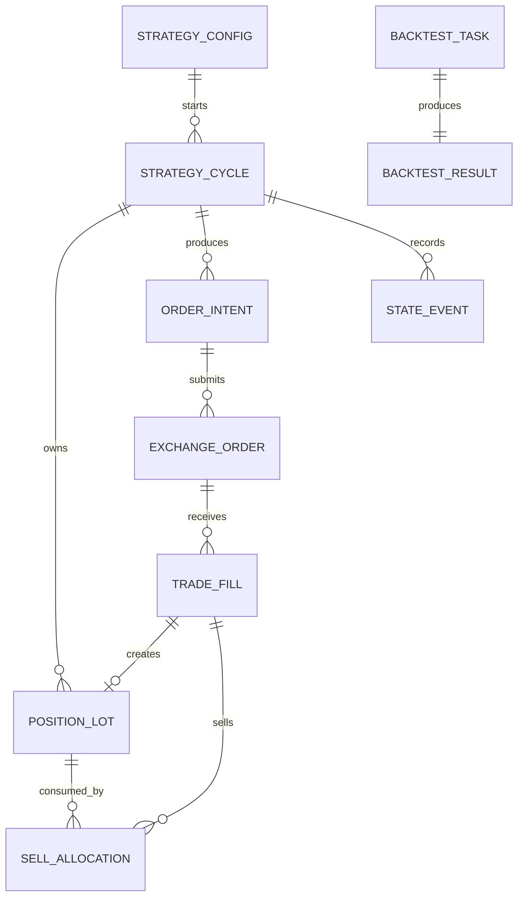

# 现货核心-卫星策略字段与事件协议

## 1. 文档目的

本文是 `spot_core_satellite` 的实现前协议，承接《现货核心-卫星分层策略规格草案》，用于统一后端、回测、前端和审计模块的数据语义。

截至 2026-08-21，协议中的核心模型、数据库迁移、回测任务、逐笔 Lot、卖出分配、状态事件、查询 API 和前端页面已经实现。实盘 Trader 仍由服务端强制限制为模拟模式，协议中的真实交易命令关联保留为后续安全开放点。

## 2. 核心关系



核心原则：

1. `trade_fill` 是交易所实际成交事实，不可修改。
2. 第一阶段一条买入成交创建一个 `position_lot`，同一委托的多次部分成交形成多个可追溯批次。
3. 卖出成交通过 `sell_allocation` 核销一个或多个批次。
4. 账户余额只用于对账，不能替代策略批次账本。
5. 所有金额、数量和价格使用定点十进制，不使用浮点数。

## 3. 枚举协议

### 3.1 策略状态

| 值 | 含义 |
|---|---|
| `draft` | 草稿，不生成信号 |
| `active` | 已启用，可运行 |
| `paused` | 人工暂停 |
| `risk_off` | 风控暂停，需要人工恢复 |
| `stopped` | 已停止，不再自动恢复 |

### 3.2 周期状态

| 值 | 含义 |
|---|---|
| `WAIT` | 等待有效低位或新周期 |
| `ACCUMULATE` | 有限阶梯建立核心仓 |
| `RANGE_TRADING` | 使用波段仓交易震荡 |
| `BREAKOUT` | 突破确认和波段止盈 |
| `DISTRIBUTION` | 长趋势中的核心仓分配 |
| `RISK_OFF` | 风控冻结新增风险 |

### 3.3 批次状态

| 值 | 判定 |
|---|---|
| `open` | `remaining_qty > 0` 且没有卖出预占 |
| `reserved` | 部分或全部数量被未终结卖单预占 |
| `partial_closed` | 已发生核销且 `remaining_qty > 0` |
| `closed` | `remaining_qty = 0` |
| `reconciling` | 账本与交易所成交不一致，禁止继续卖出 |

### 3.4 资金桶

第一阶段只允许：

- `core`：核心仓。
- `satellite`：波段仓。

现金不形成现货批次，由周期资金账户记录为 `reserve`。

## 4. 策略配置协议

### 4.1 顶层字段

| 字段 | 类型 | 必填 | 说明 |
|---|---|---:|---|
| `id` | string | 是 | 策略实例 ID |
| `user_id` | string | 是 | 数据所有者 |
| `exchange_config_id` | string | 是 | 交易所账户配置 |
| `strategy_type` | string | 是 | 固定为 `spot_core_satellite` |
| `market` | string | 是 | 固定为 `spot` |
| `symbol` | string | 是 | 例如 `BTCUSDT` |
| `quote_asset` | string | 是 | 第一阶段固定 `USDT` |
| `budget` | decimal | 是 | 独立策略预算 |
| `config_version` | int | 是 | 每次修改递增 |
| `status` | enum | 是 | 策略状态 |
| `parameters` | object | 是 | 规格文档第 3 节参数 |
| `created_at` | datetime | 是 | 创建时间 |
| `updated_at` | datetime | 是 | 更新时间 |

### 4.2 配置约束

- 同一 `exchange_config_id + market + symbol` 第一阶段只能绑定一个运行中的该类型策略。
- `core_budget_ratio + satellite_budget_ratio + minimum_cash_ratio` 必须等于 `100%`。
- 修改配置只影响新决策；已经创建的批次保留其 `config_version` 和原目标参数。
- 修改卖出目标时不得追溯覆盖已有批次，必须产生显式批次调整事件。
- 从 `draft` 切换到 `active` 前必须完成余额、交易规则、行情源和时钟检查。

## 5. 策略周期协议

| 字段 | 类型 | 说明 |
|---|---|---|
| `id` | string | 周期 ID |
| `strategy_id` | string | 策略实例 |
| `config_version` | int | 周期启动时使用的配置版本 |
| `state` | enum | 当前六状态之一 |
| `initial_budget` | decimal | 周期初始预算 |
| `available_cash` | decimal | 当前可用现金 |
| `reserved_cash` | decimal | 未成交买单预占现金 |
| `realized_pnl` | decimal | 周期已实现净收益 |
| `unrealized_pnl` | decimal | 按最新价格计算的未实现收益 |
| `started_at` | datetime | 周期开始时间 |
| `ended_at` | datetime/null | 周期结束时间 |
| `version` | int | 乐观锁版本 |

周期内必须满足：

```text
available_cash + reserved_cash + open_lot_cost = initial_budget + realized_pnl
```

其中 `realized_pnl` 是扣除买卖费用后的累计净收益。市值权益单独使用最新价格计算，不得与成本账本恒等式混用。

## 6. 买入批次协议

### 6.1 `position_lot`

| 字段 | 类型 | 说明 |
|---|---|---|
| `id` | string | 批次 ID |
| `strategy_id` | string | 所属策略 |
| `cycle_id` | string | 所属周期 |
| `account_id` | string | 交易账户 |
| `exchange` | string | `binance`、`okx` 等 |
| `market` | string | 固定 `spot` |
| `symbol` | string | 交易对 |
| `bucket` | enum | `core` 或 `satellite` |
| `layer_no` | int | 建仓层级 |
| `source_order_intent_id` | string | 来源订单意图 |
| `source_buy_fill_id` | string | 唯一来源买入成交 |
| `acquired_qty` | decimal | 该成交实际买入数量 |
| `remaining_qty` | decimal | 尚未核销数量 |
| `reserved_qty` | decimal | 已被卖单预占数量 |
| `total_cost` | decimal | 含买入手续费的累计 USDT 成本 |
| `unit_cost` | decimal | `total_cost / acquired_qty` |
| `target_net_profit_rate` | decimal | 净利润目标 |
| `target_price` | decimal | 根据成本和预计卖出费用计算 |
| `config_version` | int | 创建批次时的配置版本 |
| `status` | enum | 批次状态 |
| `opened_at` | datetime | 首次买入成交时间 |
| `closed_at` | datetime/null | 完全核销时间 |
| `version` | int | 乐观锁版本 |

可卖数量必须统一计算：

```text
available_lot_qty = remaining_qty - reserved_qty
```

任何卖出意图都不得超过 `available_lot_qty`。

第一阶段固定采用“一条买入成交一个批次”。前端可以按 `strategy_id + cycle_id + bucket + layer_no` 聚合同层展示，但后端核销必须落到原始批次，不得把聚合展示结果当作新成本记录。

### 6.2 批次示例

| 批次 | 成本价 | 数量 | 资金桶 | 目标状态 |
|---|---:|---:|---|---|
| `LOT-01` | `78000` | `0.01 BTC` | `core` | 仅分配阶段可卖 |
| `LOT-02` | `65000` | `0.01 BTC` | `satellite` | 等待自身净利润目标 |
| `LOT-03` | `58000` | `0.01 BTC` | `satellite` | 达标后优先生成卖出意图 |

价格达到 `LOT-03` 的目标时，系统只预占并卖出 `LOT-03` 的可用数量。账户中虽然共有 `0.03 BTC`，但不能用平均成本替代批次选择。

## 7. 订单与成交协议

### 7.1 `order_intent`

| 字段 | 类型 | 说明 |
|---|---|---|
| `id` | string | 意图 ID |
| `idempotency_key` | string | 全局唯一幂等键 |
| `strategy_id`、`cycle_id` | string | 业务归属 |
| `state_event_id` | string | 触发该意图的状态或信号事件 |
| `side` | enum | `buy` 或 `sell` |
| `bucket` | enum | `core` 或 `satellite` |
| `layer_no` | int/null | 买入层级 |
| `source_lots` | array | 卖出时的批次和计划数量 |
| `order_type` | enum | 第一阶段 `limit` |
| `price`、`quantity` | decimal | 计划价格与数量 |
| `reason_code` | string | 机器可读触发原因 |
| `signal_snapshot` | object | 触发时使用的收盘行情和指标 |
| `status` | enum | `created/validated/submitted/partial/filled/cancelled/rejected` |

### 7.2 `trade_fill`

交易所每条成交明细必须唯一保存，唯一键建议使用：

```text
exchange + account_id + market + symbol + exchange_trade_id
```

成交字段至少包括成交单号、订单号、方向、价格、数量、手续费、手续费币种、成交时间和原始响应摘要。同步任务重复拉取同一成交时必须幂等。

## 8. 卖出核销协议

### 8.1 `sell_allocation`

| 字段 | 类型 | 说明 |
|---|---|---|
| `id` | string | 核销 ID |
| `sell_fill_id` | string | 卖出真实成交 |
| `lot_id` | string | 被核销买入批次 |
| `allocated_qty` | decimal | 从该批次核销的数量 |
| `allocated_cost` | decimal | 该数量对应的含费买入成本 |
| `allocated_buy_fee` | decimal | 用于审计的买入费用分摊 |
| `allocated_sell_fee` | decimal | 卖出费用分摊 |
| `net_proceeds` | decimal | 扣除卖出费用后的收入 |
| `realized_pnl` | decimal | 已实现净收益 |
| `realized_pnl_rate` | decimal | 已实现净收益率 |
| `created_at` | datetime | 核销时间 |

### 8.2 核销事务

处理卖出成交必须在同一个数据库事务中完成：

1. 使用唯一键插入或读取 `trade_fill`。
2. 锁定卖出意图指定的批次。
3. 校验批次策略、周期、币种和资金桶一致。
4. 按计划分配顺序生成 `sell_allocation`。
5. 减少 `remaining_qty` 和 `reserved_qty`。
6. 汇总周期已实现收益和可用现金。
7. 写入账本事件并提交事务。

以下任一情况必须回滚并标记 `reconciling`：

- 可分配数量小于卖出成交数量。
- 核心仓被波段意图引用。
- 批次已经关闭或属于其他策略。
- 同一成交出现不同的数量、价格或费用。
- 分配后数量为负或账本恒等式不成立。

## 9. 状态事件协议

每次状态判断都写入 `state_event`，即使状态没有变化也允许记录 `STATE_EVALUATED`，以便回放。

| 字段 | 类型 | 说明 |
|---|---|---|
| `id` | string | 事件 ID |
| `strategy_id`、`cycle_id` | string | 业务归属 |
| `event_type` | string | 事件类型 |
| `from_state`、`to_state` | enum | 转换前后状态 |
| `reason_code` | string | 机器可读原因 |
| `market_time` | datetime | 行情发生时间 |
| `processed_at` | datetime | 系统处理时间 |
| `config_version` | int | 使用的参数版本 |
| `signal_snapshot` | object | K 线、均线、回撤、成交量等输入 |
| `risk_snapshot` | object | 现金、敞口、回撤和流动性检查 |
| `correlation_id` | string | 串联事件、意图、订单和成交 |

首批事件类型：

- `CYCLE_STARTED`
- `STATE_EVALUATED`
- `STATE_CHANGED`
- `BUY_LAYER_TRIGGERED`
- `LOT_TARGET_REACHED`
- `SELL_LOTS_SELECTED`
- `RISK_OFF_TRIGGERED`
- `MANUAL_RESUME_CONFIRMED`
- `CYCLE_COMPLETED`
- `RECONCILIATION_FAILED`

## 10. 回测任务接口草案

遵循现有 `/api/v1/trading` 路径，建议新增：

| 方法 | 路径 | 用途 |
|---|---|---|
| `POST` | `/api/v1/trading/backtests` | 创建回测任务 |
| `GET` | `/api/v1/trading/backtests/{id}` | 查询任务状态 |
| `GET` | `/api/v1/trading/backtests/{id}/result` | 获取指标和对照组结果 |
| `GET` | `/api/v1/trading/backtests/{id}/events` | 分页查询状态和交易事件 |
| `POST` | `/api/v1/trading/backtests/{id}/cancel` | 取消未完成任务 |

### 10.1 创建请求

```json
{
  "strategy_type": "spot_core_satellite",
  "symbols": ["BTCUSDT", "ETHUSDT"],
  "exchange": "binance",
  "start_time": "2020-01-01T00:00:00Z",
  "end_time": "2025-12-31T23:59:59Z",
  "initial_capital": "100000",
  "parameters": {},
  "cost_scenario": {
    "fee_rate_bps": "10",
    "slippage_bps": "5"
  },
  "benchmarks": ["buy_and_hold", "fixed_dca", "spot_grid", "core_only"]
}
```

### 10.2 任务状态

```text
queued -> loading_data -> running -> calculating -> completed
                                      |              |
                                      v              v
                                    failed       cancelled
```

每次状态改变必须记录进度、已处理行情时间、错误码和可重试标记。失败重试必须复用原始参数快照，不能读取已经修改的新配置。

### 10.3 结果摘要

结果至少返回：

- 数据版本、参数快照、代码版本和成本场景。
- 总收益、年化收益、最大回撤、Calmar、Sortino 和 Sharpe。
- 波段 Profit Factor、费用占毛利润、换手率和平均现金比例。
- 各资金桶的已实现与未实现收益。
- 每个批次的开仓、部分核销、完全关闭和净收益。
- 各状态持续时间、转换次数和风控事件。
- 所有对照组的同口径指标和相对差异。
- 安全硬门槛、量化门槛和压力验收的逐项结果。

## 11. 验收用例

### 11.1 三批次独立卖出

给定三个 `0.01 BTC` 批次，成本分别为 `78000`、`65000`、`58000`，当价格只达到 `58000` 批次目标时：

- 只能为 `58000` 批次创建卖出预占。
- 卖出成交只能核销该批次。
- 另外两个批次的 `remaining_qty` 不变。
- 核销后账户余额与批次剩余数量之和一致。

### 11.2 部分成交

计划卖出 `0.01 BTC`，实际只成交 `0.004 BTC` 时：

- 只核销 `0.004 BTC`。
- 剩余 `0.006 BTC` 继续保留或在撤单后释放预占。
- 收益只按 `0.004 BTC` 计算。

### 11.3 多批次一次成交

一笔成交核销两个波段批次时：

- 两条 `sell_allocation` 数量之和等于成交数量。
- 两个批次分别计算成本和净收益。
- 不得将合并平均成本回写到原批次。

### 11.4 禁止跨桶核销

波段卖出意图引用核心批次时，校验必须失败，不能提交交易所订单。

### 11.5 重复成交同步

同一个交易所成交被定时任务重复拉取时，不得重复核销、重复增加现金或重复计算收益。

## 12. 下一步

1. 将本文协议映射到现有 trading schema、repository 和 service 边界。
2. 输出数据库表及索引迁移设计，重点验证成交唯一键和批次并发锁。
3. 先实现纯内存状态机和批次账本单元测试。
4. 再实现历史行情回测，不接真实交易账户。
5. 回测通过安全硬门槛后，才进入模拟实时运行。
