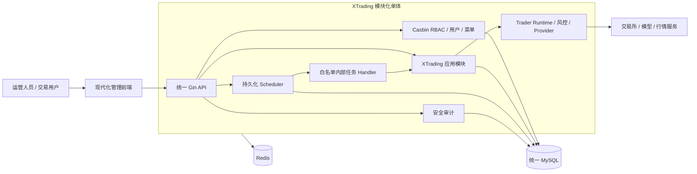

# XTrading 融合架构与实施记录

## 1. 文档目的

本目录记录 XTrading 以 `LyricTian/gin-admin` 为后台基础，将旧 NOFX 交易能力、现代化管理前端、持久化定时任务和统一 MySQL 融合为一个系统的架构决策与实施过程。

本项目不是两个服务之间的 API 拼接，也不是保留两套用户和数据库，而是：

- 一个 Git 仓库
- 一个 Go 后端入口
- 一个现代化 React 管理前端
- 一套 Casbin RBAC
- 一套 MySQL 数据库和迁移体系
- 一套 Redis 缓存、任务协调和运行时租约
- 一个进程内 XTrading Runtime 边界

## 2. 已确认的技术决策

| 决策项 | 正式决定 |
| --- | --- |
| 产品品牌 | 产品统一为 `XTrading`，管理端显示 `XTrading Console`，后端和运行时使用 `XTrading Server` / `XTrading Runtime` |
| 后台基础 | 使用 `LyricTian/gin-admin` v10 |
| 前端 | 使用官方 `gin-admin/gin-admin-frontend`，迁入同一仓库 `web/` 并升级到 Umi 4、React 18、Ant Design 5 |
| 权限 | 使用 gin-admin Casbin RBAC，业务数据范围在 Repository 层强制执行 |
| 定时任务 | 新增持久化 Scheduler 模块，参考旧融合项目已完成实现和 go-admin 产品交互 |
| 数据库 | XTrading、Scheduler、RBAC、审计共用同一个 MySQL 数据库和连接池 |
| 项目形态 | 模块化单体，不保留独立 NOFX HTTP 服务和双重登录 |
| 交易运行时 | 进程内独立 Runtime 模块，不使用 Cron 替代 Trader 策略循环 |
| 旧项目 | `nofx-shiyu-admin` 冻结为迁移来源，不删除、不覆盖 |

## 3. 项目基线

| 项目 | 本地目录 | 基线提交 | 用途 |
| --- | --- | --- | --- |
| gin-admin | `../nofx-gin-admin` | `2287d87e0bc55a2b570176feb27ea9f494c5e45e` | 新系统后台和 RBAC 基线 |
| NOFX | `../nofx` | `d3de5e82aa02098b1d329274f0f9c89c5661d620` | 交易引擎、Provider、策略和运行时来源 |
| 旧融合项目 | `../nofx-shiyu-admin` | `a7f02c90d29af1d02f980a1cda081f6e9232bc35` 加当前未提交实现 | Scheduler、交易只读域、迁移器和管理页面迁移来源 |

gin-admin 原始基线使用 Go 1.19、Gin 1.9、GORM 1.24、JWT v3 和 Redis v8。当前融合分支已升级到 Go 1.26、Gin 1.12、GORM 1.31、JWT v5、Redis v9，并将 AWS SDK v1 迁移到 v2。详细记录见 [前端接入与依赖升级](./03-frontend-and-dependency-upgrade.zh-CN.md)。

本地一体化环境见 [Docker 测试环境](./05-docker-test-environment.zh-CN.md)。

交易配置写入、Trader 生命周期和前端操作见 [交易管理闭环](./06-trading-management-lifecycle.zh-CN.md)。

NOFX 功能迁移范围、优先级和持续状态见 [NOFX 功能迁移清单](./07-nofx-feature-migration-checklist.zh-CN.md)。

前端字号层级、Ant Design Token 和响应式文字规则见 [前端字体与字号规范](./08-frontend-typography-spec.zh-CN.md)。

交易所迁移状态、数据源覆盖和限制见 [Provider 与数据源能力矩阵](./08-provider-and-data-source-matrix.zh-CN.md)。

注册、策略市场、量化数据、DEX、X402 和 Backtest 的当前边界见 [产品范围决策](./09-product-scope-decisions.zh-CN.md)。

现货核心-卫星策略的参数、状态转换和回测验收见 [现货核心-卫星分层策略规格](./10-spot-core-satellite-strategy-spec.zh-CN.md)。

该策略的批次库存、卖出核销、状态事件和回测任务字段见 [现货核心-卫星策略字段与事件协议](./11-spot-core-satellite-contracts.zh-CN.md)。

当前仓库目录、Go module 路径和旧数据导入命令 `import-nofx` 暂时保留，分别用于上游兼容、历史追踪和旧数据迁移；它们不是对外产品名称。Docker 当前数据卷已迁移为 `xtrading-local_*`，旧卷只作为本机回滚副本保留，不再挂载到服务。

## 4. 目标架构



## 5. 目标目录

```text
nofx-gin-admin/
├── cmd/                              # 单一服务入口和迁移命令
├── configs/                          # 环境配置，不保存生产密钥
├── internal/
│   ├── bootstrap/                    # HTTP、DB、Redis、Runtime 生命周期
│   ├── mods/
│   │   ├── rbac/                     # gin-admin 原 Casbin 模块
│   │   ├── scheduler/                # 持久化任务管理
│   │   └── trading/                  # XTrading 交易应用模块
│   │       ├── api/
│   │       ├── biz/
│   │       ├── dal/
│   │       ├── schema/
│   │       ├── credential/
│   │       ├── migration/
│   │       ├── provider/
│   │       └── runtime/
│   ├── migration/                    # 统一 MySQL 版本迁移
│   └── wirex/                        # Wire 依赖注入
├── pkg/                              # 无业务归属的公共能力
├── web/                              # 升级后的 React 管理前端
├── docs/nofx-integration/            # 决策、迁移和验收记录
├── migrations/                       # 可审计 SQL/Go 迁移
└── deploy/                           # Docker Compose 和部署文件
```

## 6. 统一 MySQL 规则

所有模块使用同一个 MySQL 实例、数据库和 GORM 连接池。

建议表前缀：

| 范围 | 前缀 | 示例 |
| --- | --- | --- |
| gin-admin 系统表 | `sys_` | `sys_users`、`sys_roles` |
| 交易业务表 | `trading_` | `trading_traders`、`trading_positions` |
| 定时任务表 | `trading_scheduled_` | `trading_scheduled_tasks`、`trading_scheduled_task_runs` |
| 高风险审计 | `audit_` | `audit_trading_commands` |

数据库规则：

1. 字符集统一为 `utf8mb4`。
2. 数据库存储时间统一使用 UTC，API 明确时区。
3. 金额、价格、数量和费率使用明确精度的 `DECIMAL`，禁止使用浮点字段持久化资金数据。
4. 生产环境禁止应用启动时无版本地执行全量 `AutoMigrate`。
5. 使用版本化迁移并记录迁移历史。
6. 不允许同时向旧 NOFX 数据库和新 MySQL 双写。
7. 密钥字段只保存加密密文，API 只返回脱敏值和配置状态。

## 7. 定时任务边界

Scheduler 是管理型基础设施，不是交易策略运行器。

允许的任务：

- 系统健康检查
- Provider 健康检查
- 账户和仓位快照
- 订单、成交和仓位对账
- 报表生成
- 日志和历史执行记录清理
- 受控的 Trader 定时启停命令

禁止的任务：

- 任意 Shell
- 任意 SQL
- 任意 HTTP URL
- 用户上传代码
- 绕过风控直接下单
- 使用 Cron 替代 `AutoTrader` 的持续策略扫描循环

Scheduler 必须支持：持久化定义、Cron 和时区、手工触发、超时、有限重试、misfire 策略、并发策略、执行历史、RBAC、审计和多实例防重。

## 8. 前端升级原则

gin-admin 原前端只作为页面、权限和接口行为参考，不继续停留在 React 17、Ant Design 4 和 Umi 3。

升级目标：

- React 18 或更高稳定版本
- TypeScript 严格模式
- 当前稳定的 Ant Design / Ant Design Pro
- 当前稳定路由和构建工具
- OpenAPI 类型生成
- 统一请求错误处理
- Casbin 菜单和按钮权限
- 可测试的表格、表单和高风险确认流程

升级必须按页面垂直切片进行，禁止一次性只升级依赖版本后集中修复全部页面。

## 9. 安全前置

以下问题必须在迁入交易密钥和实盘能力前完成：

1. 移除固定管理员密码和 MD5 密码方案。
2. 初始管理员凭证通过环境变量或一次性初始化流程设置。
3. 升级 JWT 库并支持令牌吊销、过期和密钥轮换策略。
4. 配置输出必须脱敏，不能打印数据库、Redis、模型和交易所凭证。
5. 交易所、模型、钱包密钥使用 AES-GCM 或外部 KMS 加密。
6. 所有高风险操作记录不可丢审计。
7. Casbin 控制功能权限，Repository 同时强制租户和数据所有权。
8. 对外 Base URL 执行 SSRF、DNS 重绑定和重定向校验。

## 10. 实施顺序

### 阶段 0：基线与安全升级

- 锁定 gin-admin 上游提交。
- 记录原始基线测试结果。
- 升级 Go、Gin、GORM、JWT、Redis、Casbin 等关键依赖。
- 修复固定密码、MD5、配置泄密和默认生产配置问题。
- 建立依赖升级测试和安全检查。

### 阶段 1：统一基础设施

- 默认开发环境改为 MySQL。
- 建立版本化数据库迁移。
- 增加 Redis、MySQL 和应用 Docker Compose。
- 确立统一表前缀、用户标识和审计上下文。
- 建立现代前端骨架和登录/RBAC 最小闭环。

### 阶段 2：迁移 Scheduler

- 从旧融合项目迁移任务领域规则和测试。
- 按 gin-admin `api/biz/dal/schema` 结构重建。
- 接入 Casbin、菜单、操作审计和现代前端页面。
- 先启用安全白名单任务。

### 阶段 3：迁移交易只读域

- 交易账户、Trader、策略、模型、交易所、决策等 MySQL 模型。
- 旧 NOFX 数据 dry-run、映射、幂等导入和迁移报告。
- 余额、仓位、订单和成交只读 API。
- 数据范围、脱敏和审计。

### 阶段 4：迁移 Provider 和 Runtime 边界

- 交易所和数据 Provider 注册表。
- Provider 健康检查、超时、限流和降级。
- Runtime 实例注册、心跳和租约。
- Trader 启动预检和最小模拟 Runtime。

### 阶段 5：受控交易闭环

- Trader 状态机和恢复。
- 决策、风控、订单、成交和仓位闭环。
- 启停、撤单、平仓等高风险命令。
- 幂等、二次确认、审计和故障对账。

## 11. 当前状态

- [x] 确认使用 gin-admin。
- [x] 确认升级前端。
- [x] 确认新增持久化定时任务。
- [x] 确认统一 MySQL。
- [x] 确认融合为一个模块化单体系统。
- [x] 创建 `nofx-gin-admin` 并锁定上游提交。
- [x] 执行上游 API 基线测试并记录 `no such table: role` 失败。
- [x] 修复测试数据库自动迁移顺序，`go test ./test` 可重复通过。
- [x] 建立 `trading` 模块及交易所、模型、策略、Trader 四个核心 MySQL 模型。
- [x] 完成四个核心配置域的 CRUD API、用户数据范围、凭证脱敏和 Casbin 菜单/按钮资源。
- [x] Wire 固定升级到 `v0.7.0` 并重新生成依赖注入代码。
- [x] 导入官方 `gin-admin-frontend` 到 `web/`，完成 Umi 4 和 Ant Design Pro 2 适配。
- [x] 完成前后端依赖升级，JWT、Redis 限流器和 AWS SDK 完成主版本迁移。
- [x] 移除前端登录页预填的固定管理员账号密码。
- [x] 迁移账户快照、仓位、决策模型及用户范围只读 API。
- [x] 建立 AES-256-GCM 凭证服务、旧密文兼容和密钥轮换入口。
- [x] 建立 dry-run、幂等、可审计的旧 NOFX 数据导入器及 `import-nofx` CLI。
- [x] 接入 Binance、Bybit、OKX 永续账户只读 Provider。
- [x] 建立 Trader Runtime 注册、数据库租约和账户/仓位周期同步。
- [x] 建立 app + MySQL + Redis 的 Docker Compose 一体化测试配置。
- [x] 完成交易所、AI 模型、策略和 Trader 管理页面及表单校验。
- [x] 完成交易所只读连接测试、Trader 启停/立即同步 API、启动预检和前端二次确认。
- [x] 完成账户快照、仓位和决策观察页面。
- [x] 完成策略复制、单一激活事务约束和策略工作室操作入口。
- [ ] 完成剩余安全基线：服务端 MD5 密码方案、初始管理员引导和生产密钥治理。
- [ ] 完成 MySQL 开发环境。
- [x] 完成现代前端登录/RBAC 骨架。
- [ ] 开始迁移 Scheduler。
- [ ] 完成 Provider 真实测试网验收、限流、指标和告警。
- [ ] 完成交易命令专用审计表、Runtime 进程重启恢复和状态机故障恢复；当前不开放实盘交易。
