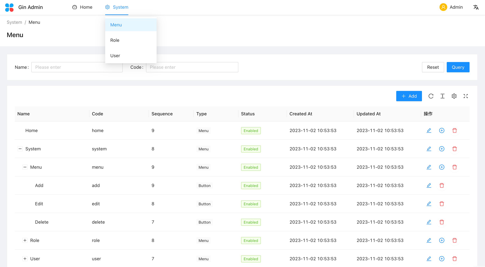

# XTrading Console

XTrading 管理前端，统一管理交易所账户、AI 模型、策略、Trader Runtime 和观察数据。项目基于官方 [gin-admin-frontend](https://github.com/gin-admin/gin-admin-frontend) 迁入，并与本仓库 Go 后端统一维护。



## Features

- :gem: **Neat Design**: Follow Ant Design specification
- :triangular_ruler: **Common Templates**: Typical templates for enterprise applications
- :rocket: **State of The Art Development**: Newest development stack of React/umi/dva/antd
- :cn: **International**: Built-in i18n solution
- :closed_lock_with_key: **RBAC**: Support rbac permission management

## 环境要求

> You can use [nvm](https://github.com/nvm-sh/nvm) to manage node version.

- Node.js 22 或更高版本
- npm 10 或更高版本

## 本地运行

```bash
npm install
npm run dev
```

默认后端 API 地址在 `src/services/index.ts` 中配置。也可以从仓库根目录执行 `make web-dev`。

## 验证与构建

```bash
npm run typecheck
npm run build
```

完整版本选择、升级约束和验证结果见 `docs/nofx-integration/03-frontend-and-dependency-upgrade.zh-CN.md`。

## MIT License

```text
Copyright (c) 2023 Lyric
```
